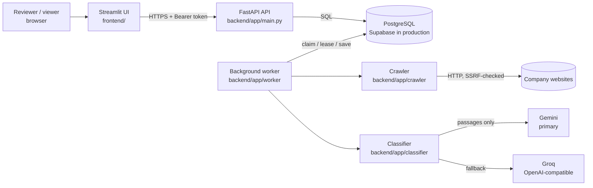
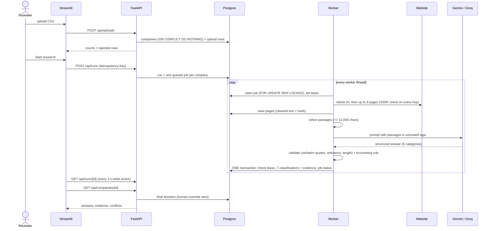
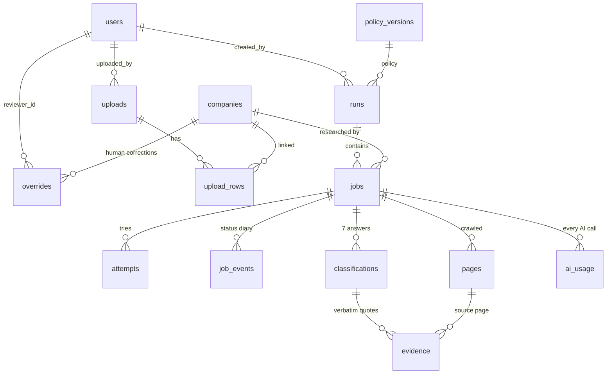
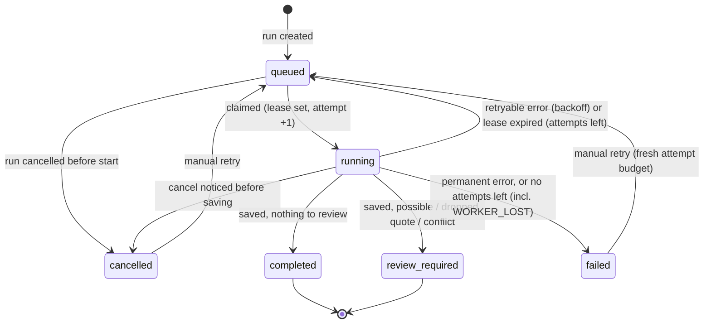
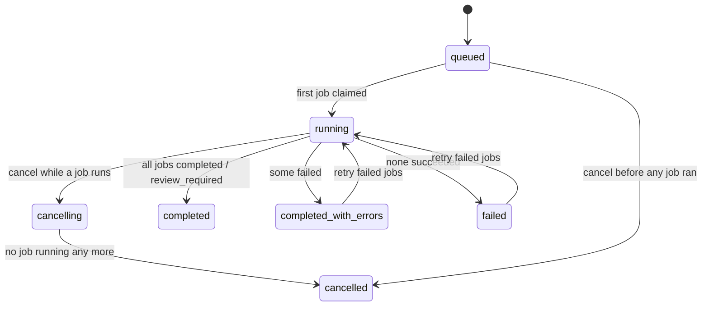
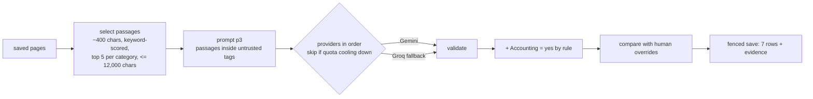

# Design

Business Evidence Platform researches public company websites, classifies seven business lines (Accounting,
Agronomy, Grain, Energy, Feed, Gas Station, Retail Store) with **verbatim evidence**, and lets reviewers correct the
results. This document explains how it is built and why. Detailed history: `docs/decision-log.md`; proof:
`docs/evidence/README.md`.

## 1. System architecture

- **The UI never touches the database**: `frontend/api_client.py` is the only file that talks to the backend.
- **The API never crawls or calls the AI**: it stores requests (companies, runs, jobs) and answers in milliseconds.
- **The worker does the slow work** (crawl -> classify -> save) and coordinates with other workers only through
  Postgres (row locks + leases). There is no separate queue system: **Postgres is the queue** (see section 11).

## 2. From upload to final result

## 3. Data model

14 tables (`backend/app/db/models.py`). The rules that matter are enforced **by the database**, so they hold
under races and crashes:

| Rule | Constraint |
|---|---|
| one company per website | `UNIQUE companies.canonical_domain` |
| one run per double-click | `UNIQUE runs.idempotency_key` |
| one job per company per run | `UNIQUE jobs (run_id, company_id)` |
| at most one active (queued/running) job per company | partial unique index `uq_jobs_one_active_per_company` |
| one answer per category per job | `UNIQUE classifications (job_id, category)` |
| two reviewers can't both save version N | `UNIQUE overrides (company_id, category, version)` |
| one row per crawled URL per job | `UNIQUE pages (job_id, url)` |
| valid statuses / categories / sources | `CHECK` constraints (strings, not Postgres ENUMs, so values are easy to add) |

Overrides are **append-only** (never updated or deleted): the current human answer is the highest version;
`new_status = NULL` means "correction removed". Pages store **cleaned text** (max 50,000 chars) + SHA-256, never raw
HTML. `companies.source` labels test data (`user` / `fixture` / `synthetic`).

## 4. Job and run states

The run status is **always recomputed from its jobs** (with the run row locked), never set by hand; progress =
finished jobs / total, from the database.

## 5. Retries, leases, fencing, recovery

| Mechanism | How |
|---|---|
| Claim | `SELECT ... FOR UPDATE SKIP LOCKED` on the oldest ready job (`queued`, `next_attempt_at <= now()`, run not cancelling): two workers never get the same job and never wait for each other |
| Lease | `lease_owner = <host:pid:thread>`, `lease_expires_at = now() + 120 s` (database clock); a heartbeat thread renews every lease/3 |
| Recovery | before every claim, expired leases are found: the attempt becomes `abandoned`, the job is re-queued (or `failed` with `WORKER_LOST` when no attempts are left) |
| Fencing | the final write is ONE transaction that locks the job row and checks `status = running AND lease_owner = me`; otherwise nothing is saved and `LEASE_LOST` is logged |
| Job retry | permanent errors (`INVALID_URL`, `BLOCKED_UNSAFE`) fail at once; `NO_CONTENT`, `AI_UNAVAILABLE`, `INTERNAL_ERROR` are re-queued after `min(300, 10 x 2^(attempt-1)) s + 0-25 % jitter`, max 3 attempts |
| Page reuse | a retry reuses the `ok` pages saved by an earlier attempt (no second crawl) |
| Fetch retry | 429 / 5xx / timeouts: 2 retries per page, exponential backoff + jitter, `Retry-After` honoured up to 4 s |
| AI retry | per provider 3 attempts (timeouts, per-minute 429, 5xx, invalid / cut-off output); bad key or unknown model -> next provider at once |
| Cancel | queued jobs cancelled immediately; running jobs check before crawling and before the AI call |
| Lock order | worker: job -> run; cancel / retry-failed: run -> only queued/failed jobs (a worker never holds those) - no deadlocks |

Proof: scenarios A (hard kill), F (save fails half-way), G (concurrent edits), I (cancel) in `docs/evidence/`.

## 6. AI pipeline

- **Passage selection** (`classifier/select.py`): deterministic; duplicate-text pages are skipped; the budget
  controls cost and free-tier limits.
- **Prompt security** (`classifier/prompts.py`): page text only in the user message inside
  `<untrusted_website_content>`; a page cannot close the tag early; the system prompt says the text is data.
- **Schema** (`classifier/schema.py`): 6 site categories (Accounting is NOT offered to the model), status
  `yes / possible / not_found`, up to 3 quotes with `passage_id`.
- **Validation** (`classifier/validate.py`) - trust nothing from the model:
  1. all 6 categories exactly once (else retry);
  2. every quote must appear verbatim (whitespace/case-insensitive) in the cited passage AND in the stored page;
     otherwise dropped;
  3. `yes` / `possible` with no verified quote -> `not_found`;
  4. `yes` whose quotes contain none of the category's keywords -> `possible`;
  5. `yes` with no quote of at least 25 characters and 4 words -> `possible`;
  6. any downgrade, dropped quote, `possible` or override conflict -> job `review_required`.
- **Accounting**: `yes` with provenance `rule` for every company (policy v1); a human may correct it, the AI never.
- **Providers** (`classifier/providers.py`): Gemini `gemini-2.5-flash` primary, Groq `openai/gpt-oss-120b`
  fallback; temperature 0; client retries off (every attempt is ours and recorded in `ai_usage`); 8,192 output
  tokens; a cut-off answer is invalid output.
- **Quota breaker**: a DAILY-quota error puts the provider in a 30-minute cool-down for this worker process;
  later jobs skip it (`skipped_quota` row) instead of wasting calls.
- **Versioning**: every classification stores `prompt_version` (p3), `policy_version` (v1), `model_provider`,
  `model_name`; every AI call stores tokens, latency, outcome, error code, cost (NULL when unknown - never guessed).

## 7. Security

| Threat | Defence |
|---|---|
| SSRF (a "website" pointing at 127.0.0.1, 10.x, 169.254.169.254, ...) | only http/https, no `user:pass@`, every resolved IP must be public, redirects followed by hand and re-checked per hop; unsafe start URL = permanent `BLOCKED_UNSAFE` |
| Abusive crawling | robots.txt respected (RFC 9309: 4xx = allow, 5xx/unreachable = disallow); 8 pages, depth 2, 1.5 MB/page, 5 MB/site, 120 s per site, one request at a time per site |
| Prompt injection | page text = data inside untrusted tags; validation requires real verbatim evidence; obeying an injection gets downgraded (tested) |
| Unauthorised access | JWT login (HS256, 8 h); every `/api` route needs a user; every change needs the reviewer role; role/active re-read from the DB on every request |
| Password guessing | bcrypt; same 401 for unknown email and wrong password (dummy-hash timing); login rate limit 10/min per IP |
| Abuse / overload | rate limits: uploads 20/min, everything else 300/min; CSV max 2 MB / 5,000 rows |
| Secrets | only in environment / `.env` (git-ignored); production refuses a weak `JWT_SECRET`; the production seed requires passwords and never prints them |
| Test-only hooks | fixture routing, the private-host allowlist and the fake AI provider are ignored / refused when `ENVIRONMENT=production` (tested) |

Known gap: DNS rebinding (we resolve, then httpx resolves again) - re-checking every hop narrows the window; IP
pinning is future work.

## 8. Observability

- **Structured JSON logs** (structlog): every API request gets an `X-Request-ID` (echoed back); worker lines carry
  `worker_id`, `job_id`, `run_id`, `attempt`. Key events: `job.claimed`, `crawl.page`, `ai.call_ok` / `ai.call_failed`,
  `ai.quota_cooldown_started`, `job.lease_recovered`, `job.lease_lost`, `job.finished`.
- **History in the database**: `attempts` (every try), `job_events` (every status change with a reason),
  `ai_usage` (every AI call), `pages` (every fetched URL and its outcome).
- **Endpoints**: `/health` (process up, no DB), `/ready` (DB reachable + migration id, 503 otherwise),
  `/api/metrics` (jobs by status, retries, durations, AI calls by provider/outcome, tokens, cost or unknown).

## 9. The three most important decisions

| Decision | Why | Trade-off accepted |
|---|---|---|
| **Postgres as the job queue** (row locks + leases, no Redis/Celery) | one system to run and explain; claims, results and status change in the same transactions (fencing, no duplicates); survives worker crashes (scenario A) | polling (2 s when idle) instead of push; very high job rates would need a dedicated queue |
| **No headless browser** (plain HTTP + HTML parsing) | fast, cheap, small attack surface, fits free hosting; most co-op sites serve HTML | JavaScript-only sites return little text and end as `NO_CONTENT` or weak evidence |
| **Verbatim-quote validation** (every claim backed by an exact quote from a crawled page) | the model's answer is checked, not trusted; reviewers can click the source; injection and hallucinated quotes are caught | strict: stitched or paraphrased quotes are dropped, so some true answers become `possible` / `not_found` and go to review |

Other trade-offs: **Streamlit** (Python only, explainable; less flexible than a JS UI, page re-runs on each
interaction); **one worker process with threads** (simple; several processes would already be safe, but shared AI
rate limits are not coordinated); **LangGraph dropped** (plain staged functions are easier to explain and still
reproducible).

## 10. Scale path

| Today | At larger scale |
|---|---|
| one worker process, 1-2 threads | several worker processes / machines (claims and leases already safe); shared per-provider rate limiter (e.g. Redis token bucket) |
| in-memory quota breaker and rate-limit counters | shared store so all processes agree |
| free AI tiers (Gemini 20 requests/model/day) | paid tiers; batching; caching answers for unchanged pages (text hash) |
| company list filtered on final answers in Python | materialised "final answer" table or SQL view with indexes |
| API + worker in one free Render container | separate always-on services; autoscaling workers on queue depth |
| plain HTTP crawling | optional headless-browser lane for JS-only sites, with strict limits |
| single organisation | tenant id on every table + row-level security (Supabase RLS) |
| polling queue | `LISTEN/NOTIFY` or a dedicated queue if job rates grow far beyond thousands per hour |
